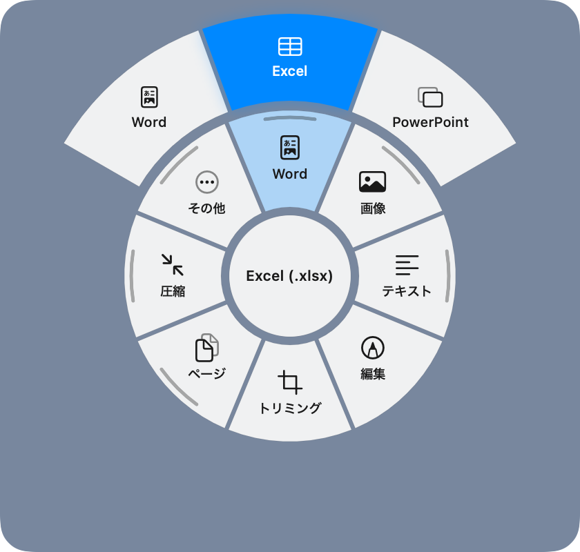
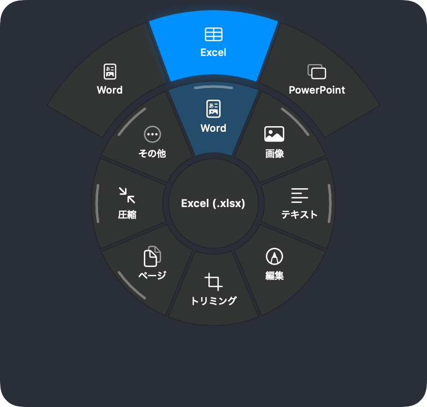

# MaruDoc

[日本語](#日本語) | [English](#english)

## 日本語

MaruDoc は、PDF、Word、Excel、PowerPoint、画像、Markdown、テキストの変換と編集を、Mac の中だけで行うアプリです。Finder の右クリックメニューと、デスクトップでファイルを長押しして出る円形メニューから使います。ファイルは外部に送られません。ネットワークに接続するコードがありません。

macOS 14 以降、Apple シリコン / Intel。MIT ライセンス。




スクリーンショットは差し替え予定です。右クリックメニューの画像も追加します。

### できること

- PDF から Word、Excel、PowerPoint、画像、Markdown、テキスト、HTML、RTF への変換。スキャンした PDF は文字認識をしてから変換する
- PDF の編集 (文字、ハイライト、手書き、図形、白塗り、墨消し、付箋、署名)、トリミング、ページの回転・削除・並べ替え、結合、分割、圧縮、パスワード、ページ番号、透かし
- 画像の変換、トリミング、回転、サイズ変更、圧縮、背景の削除、文字の読み取り、位置情報の削除
- Word、Markdown、テキスト、HTML、CSV と Excel の相互変換と編集

変換結果は元のファイルと同じ場所にでき、同じ名前があっても上書きしません。

### インストール

次のどれかを選びます。

1. https://marudoc.app から公証済みの DMG をダウンロードして、MaruDoc.app をアプリケーションフォルダに入れる
2. ターミナルで1行実行する (DMG の SHA-256、署名、チーム ID、公証を確認してから入れる)

   ```
   curl -fsSL https://marudoc.app/install.sh | sh
   ```

3. Homebrew (`MaruDoc` は公開後に実際の Organization 名に置き換える)

   ```
   brew install --cask marudoc/tap/marudoc
   ```

アンインストールは `curl -fsSL https://marudoc.app/install.sh | sh -s -- --uninstall`、または MaruDoc を終了してゴミ箱に入れます。

### 必要な権限

初回起動時に案内が出ます。システム設定で自分で許可してください。

- Finder 拡張 (一般 → ログイン項目と機能拡張 → Finder): 右クリックメニューを出すために必要
- アクセシビリティ (プライバシーとセキュリティ): デスクトップで長押ししたファイルを特定し、マウスの動きを読むために必要。キー入力は円形メニューを開いている間だけ受け取る (Esc で閉じるため)。長押しメニューを使わないなら不要
- オートメーション (Finder): 変換したファイルをデスクトップの元のファイルの隣に置くために必要。Finder に送るスクリプトは固定で、ファイルの場所は引数として渡す

### プライバシー

通信するコードがありません。ソースに URLSession、Network、WebKit、ソケット系の API はなく、Apple 標準のフレームワークだけを使い、外部ライブラリは入れていません。文字認識と背景の削除も macOS の機能で Mac の中で行います。利用状況の収集、解析ツール、アカウントはありません。

自分で確かめる方法:

- ソースを検索する: `grep -rnE "URLSession|NWConnection|CFStream|socket|import (WebKit|Network)" Sources/`
- 起動中のネットワークの口を見る: `lsof -nP -i -a -p $(pgrep -x MaruDoc)` が空になる
- LuLu や Little Snitch で通信を監視する

詳しくは [docs/08_セキュリティQ&A.md](docs/08_セキュリティQ&A.md) と [SECURITY.md](SECURITY.md)。

### ソースからビルドする

Xcode は不要で、Command Line Tools だけでビルドできます。

```
swift build                      # デバッグビルド
swift build -c release --product ensocli
swift run ensocli selftest /tmp/marudoc-selftest   # 変換エンジンの自己テスト
scripts/build_app.sh             # MaruDoc.app を組み立てる (ad-hoc 署名、出力は build/dist-direct)
```

`scripts/build_app.sh` は環境変数 `BUILD_ROOT` で出力先、`SIGN_ID` で署名の ID を変えられます。署名と公証つきのリリースは `scripts/release.sh`、Mac App Store 向けは `scripts/appstore.sh` です。どちらも自分の Apple Developer の証明書が必要です。

### 構成

- `Sources/EnsoShared`: アプリと Finder 拡張が共有するファイルの種類、操作の一覧、URL スキーム
- `Sources/EnsoDoc`: 中間の文書モデルと、Markdown、HTML、テキスト、RTF の読み書き、PDF の描画
- `Sources/EnsoOffice`: ZIP と Office Open XML (docx、xlsx、pptx) の読み書き
- `Sources/EnsoPDF`: PDF のレイアウト復元、表と画像の抽出、文字認識
- `Sources/EnsoCore`: 変換と PDF / 画像操作の実行、出力ファイル名
- `Sources/EnsoApp`: メニューバーのアプリ本体、円形メニュー、編集画面、設定
- `Sources/EnsoFinderSync`: Finder の右クリックメニュー拡張
- `Sources/ensocli`: コマンドラインからの実行と自己テスト
- `Resources`: Info.plist、entitlements、アイコン、ローカライズ
- `scripts`: ビルド、署名、公証、DMG、App Store 用のスクリプト
- `site`: https://marudoc.app のサイト (インストール用スクリプトを含む)
- `docs/08_セキュリティQ&A.md`: セキュリティの質問と答え

### ライセンス

MIT。[LICENSE](LICENSE) を参照。貢献の方法は [CONTRIBUTING.md](CONTRIBUTING.md)。

## English

MaruDoc is a macOS app that converts and edits PDF, Word, Excel, PowerPoint, image, Markdown and text files entirely on your Mac. You use it from the Finder right-click menu, or by pressing and holding a file on the desktop to open a radial menu. Files are never uploaded. The app contains no network code.

Requires macOS 14 or later, Apple silicon or Intel. MIT license.


These screenshots are placeholders. A screenshot of the right-click menu will be added.

### What it does

- Converts PDF to Word, Excel, PowerPoint, images, Markdown, text, HTML and RTF. Scanned PDFs go through OCR first.
- Edits PDF (text, highlight, freehand, shapes, white-out, true redaction, notes, signature), crops, rotates, deletes and reorders pages, merges, splits, compresses, sets a password, adds page numbers and watermarks.
- Converts, crops, rotates, resizes and compresses images, removes backgrounds, reads text, strips location metadata.
- Converts and edits Word, Markdown, text, HTML, and CSV/Excel.

Output goes next to the original file and never overwrites an existing file of the same name.

### Install

Pick one.

1. Download the notarized DMG from https://marudoc.app and drag MaruDoc.app to Applications.
2. Run one line in Terminal. It checks the DMG's SHA-256, signature, Team ID and notarization before installing.

   ```
   curl -fsSL https://marudoc.app/install.sh | sh
   ```

3. Homebrew (replace `MaruDoc` with the real organization name once the repository is published):

   ```
   brew install --cask marudoc/tap/marudoc
   ```

To uninstall, run `curl -fsSL https://marudoc.app/install.sh | sh -s -- --uninstall`, or quit MaruDoc and move it to the Trash.

### Permissions

MaruDoc shows a short guide on first launch. You grant these yourself in System Settings.

- Finder extension (General > Login Items & Extensions > Finder): needed for the right-click menu.
- Accessibility (Privacy & Security): needed to identify the file you pressed on the desktop and to read mouse movement. Key presses are received only while the radial menu is open (to close it with Esc). Not needed if you do not use the press-and-hold menu.
- Automation (Finder): needed to place converted files next to the original on the desktop. The script sent to Finder is fixed text and the file location is passed as an argument.

### Privacy

There is no code that connects to the network. The source has no URLSession, Network, WebKit or socket APIs, uses only Apple's system frameworks, and has no third-party libraries. OCR and background removal use macOS features on the Mac. There is no analytics, tracking or account.

To check for yourself:

- Search the source: `grep -rnE "URLSession|NWConnection|CFStream|socket|import (WebKit|Network)" Sources/`
- Look at the running app's network sockets: `lsof -nP -i -a -p $(pgrep -x MaruDoc)` prints nothing.
- Watch traffic with LuLu or Little Snitch.

More in [docs/08_セキュリティQ&A.md](docs/08_セキュリティQ&A.md) (Japanese) and [SECURITY.md](SECURITY.md).

### Build from source

Command Line Tools are enough. Xcode is not required.

```
swift build                      # debug build
swift build -c release --product ensocli
swift run ensocli selftest /tmp/marudoc-selftest   # conversion engine self-test
scripts/build_app.sh             # assemble MaruDoc.app (ad-hoc signed, output in build/dist-direct)
```

`scripts/build_app.sh` takes `BUILD_ROOT` for the output location and `SIGN_ID` for the signing identity. `scripts/release.sh` makes a signed and notarized DMG and `scripts/appstore.sh` builds for the Mac App Store; both need your own Apple Developer certificates.

### Project layout

- `Sources/EnsoShared`: file kinds, action catalog and URL scheme shared by the app and the Finder extension
- `Sources/EnsoDoc`: intermediate document model, Markdown / HTML / text / RTF readers and writers, PDF rendering
- `Sources/EnsoOffice`: ZIP and Office Open XML (docx, xlsx, pptx) readers and writers
- `Sources/EnsoPDF`: PDF layout reconstruction, table and image extraction, OCR
- `Sources/EnsoCore`: running conversions and PDF / image operations, output naming
- `Sources/EnsoApp`: the menu bar app, radial menu, editors, settings
- `Sources/EnsoFinderSync`: the Finder right-click extension
- `Sources/ensocli`: command-line runner and self-test
- `Resources`: Info.plist, entitlements, icons, localization
- `scripts`: build, sign, notarize, DMG and App Store scripts
- `site`: the https://marudoc.app website, including install.sh
- `docs/08_セキュリティQ&A.md`: security questions and answers (Japanese)

### License

MIT. See [LICENSE](LICENSE). To contribute, see [CONTRIBUTING.md](CONTRIBUTING.md).
